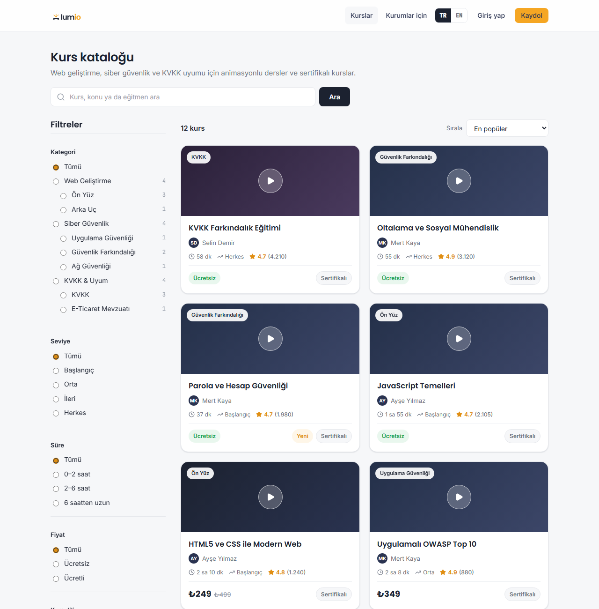
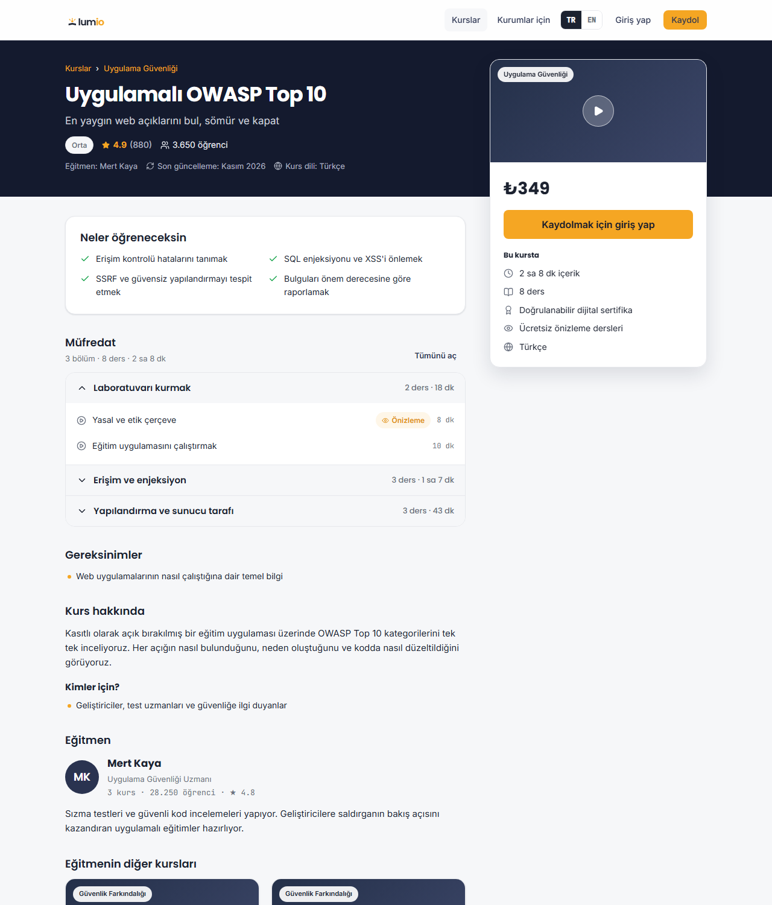
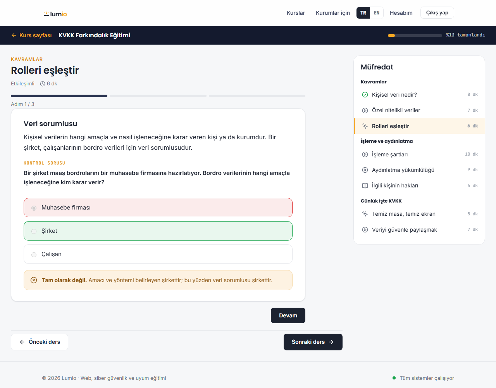
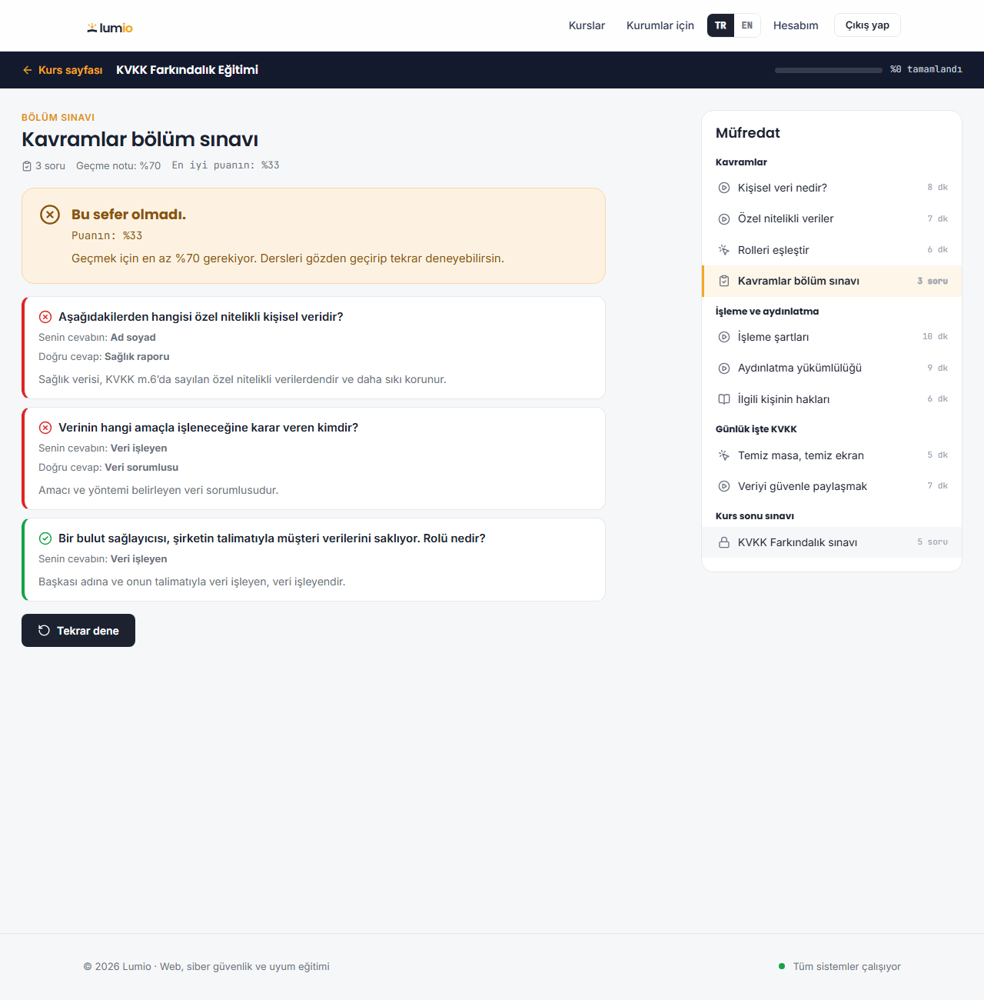
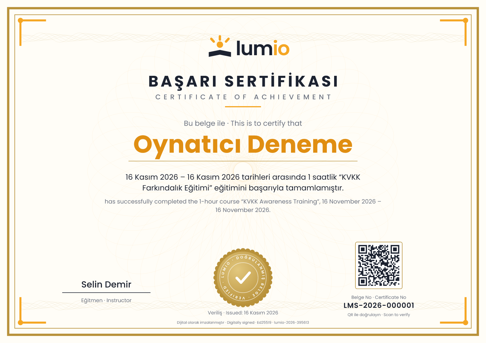
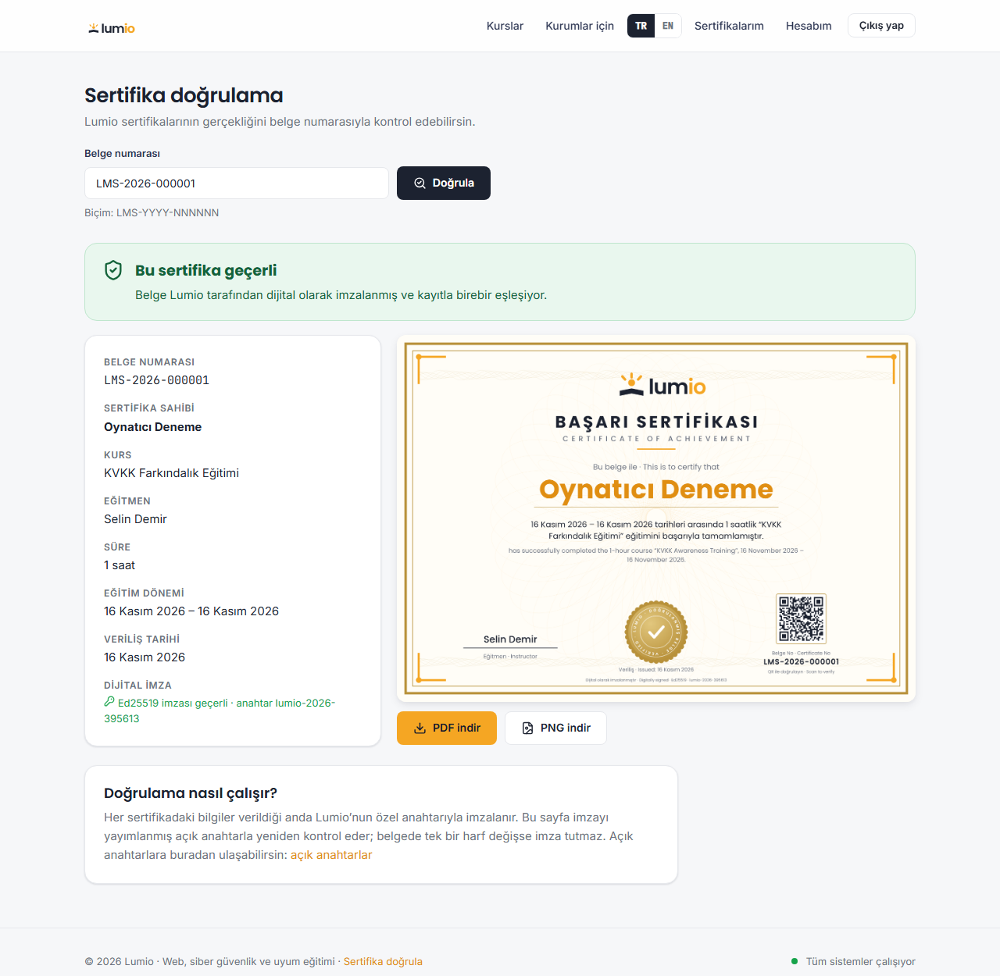
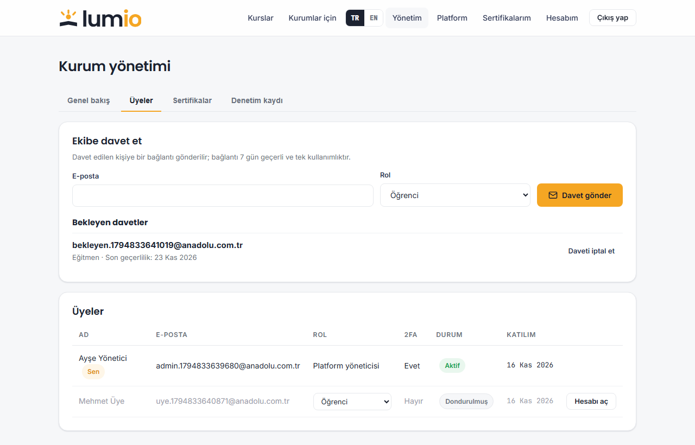

# Lumio

**Online learning platform for web, cybersecurity and compliance training.**

Companies assign courses to their employees and prove who completed what. Individuals learn through
animated lessons and quizzes, and leave with a certificate that anyone can verify without asking
Lumio. The interface and the training content are in Turkish and English.

## The idea

Compliance training is usually the part of a security programme that nobody believes in. An
employee clicks through a video, a spreadsheet records a tick, and when an auditor asks for evidence
the evidence is the spreadsheet. KVKK makes this worse, not better: a company has to show that the
people who handle personal data were trained, and the training platform itself becomes one more
place that holds personal data.

Lumio treats both halves seriously. Every organization's data is kept apart from every other
organization's at the row level, every sensitive action leaves an audit record, and every
certificate is signed so that it can be checked against the platform's public key rather than
taken on trust.

## What the platform guarantees

These are the properties the code is built to enforce. The table says honestly which ones are in
place today and which are still being built.

| Guarantee                                                                               | Status           |
| --------------------------------------------------------------------------------------- | ---------------- |
| Configuration is validated at boot; a missing, weak or example secret stops the process | In place, tested |
| Every API response carries strict security headers, `no-store` and a request id         | In place         |
| The API answers only the web origin, is rate limited, and checks a CSRF token on writes | In place         |
| One organization cannot read, change or delete another's rows                           | In place, tested |
| Passwords are hashed with argon2id; five wrong attempts lock the account for 15 minutes | In place, tested |
| Admins cannot reach the admin area without TOTP two-factor authentication               | In place, tested |
| Revoking a session, or replaying a rotated refresh token, ends that session at once     | In place, tested |
| Every critical action is written to an audit log the database refuses to edit or delete | In place, tested |
| Certificates are signed with Ed25519 and verifiable at `/dogrula/:certificateNo`        | In place, tested |

### How isolation is enforced

A signed-in request never touches the raw database client. It gets a client produced by
`scopedPrisma(orgId)` in [api/src/tenancy.ts](api/src/tenancy.ts), which adds the caller's
organization to every query on a tenant table and stamps it on every row it creates. A route that
forgets `where: { orgId }` still cannot see another organization, because the condition is added
underneath it with `AND`, so a filter for a different `orgId` matches nothing instead of widening
the scope.

[api/test/tenancy.test.ts](api/test/tenancy.test.ts) signs in two companies and checks, over HTTP
and against the scoped client directly, that neither can list, count, change, delete or revoke
anything of the other's. Turning the scope off makes those tests fail.

### Signing in

- Sessions live in httpOnly, `SameSite=Strict` cookies. The access token lasts 15 minutes; the
  refresh token is sent only to `/api/auth`, is stored as a hash, and changes on every use.
- Presenting a refresh token that was already rotated away means it was copied, so the session is
  revoked for both holders.
- Every request checks the session in the database, so signing out a device takes effect at once
  rather than when its access token expires.
- Sign-up answers the same way whether or not the address is already registered, and sign-in gives
  one error for an unknown address, a wrong password and a locked account.
- TOTP seeds are encrypted with AES-256-GCM before they are stored, and a code is accepted once.
  Turning two-factor authentication on asks for the password again, so a stolen session alone
  cannot bind a new authenticator.
- Wrong passwords and wrong codes share one counter per account. An attempt is counted before it
  is checked, so guesses sent at the same moment are each counted, and the counter only resets
  when a sign-in completes, so entering the password again does not buy more guesses at the code.
- A forgotten password is reset through a one-hour, single-use link sent to the account's address.
  A reset signs out every device and opens a locked account, so nobody can keep an owner out by
  locking their account on purpose. A half-finished sign-in begun with the old password is void.
- Verifying an email address takes the link and the password chosen at sign-up, so a stranger who
  typed someone else's address cannot have the owner activate it for them.
- Turning on two-factor authentication hands out ten single-use recovery codes, shown once and
  stored as hashes. They are the way back in when the phone is lost; a password reset alone never
  removes the second factor.

### Security review

The code was reviewed twice by tracing each entry point to the data it reaches, looking for ways
around the guarantees above. The second review ran the leads against the code in an isolated
container. Every lead was first turned into a test that failed, then fixed, and the test now
guards the fix. What was found and changed:

| Lead                                                                              | Fix                                                                                               |
| --------------------------------------------------------------------------------- | ------------------------------------------------------------------------------------------------- |
| An admin who was demoted kept their pending admin invitations and could come back | Demoting or deactivating revokes their invitations; accepting checks the sender is still an admin |
| An unverified sign-up could hold someone else's address                           | A newer sign-up, an invitation or a reset replaces it; verifying needs the registrant's password  |
| Re-entering the password reset the counter for code guesses                       | The counter resets only after the whole sign-in succeeds                                          |
| Guesses sent together were counted as one                                         | Each attempt is taken from the counter atomically, before it is checked                           |
| Anyone could keep an account locked                                               | The owner can reset the password, which opens the account                                         |
| Compose started on secrets written in the repository                              | Compose requires them; `npm run env:init` writes fresh random ones; example values are refused    |
| Concurrent final exam attempts could exceed three a day                           | The count and the new attempt are one locked step                                                 |
| Two admins demoting each other at once could leave nobody in charge               | Membership changes in an organization run one at a time                                           |
| Names could carry line breaks into emails                                         | Names refuse control characters                                                                   |
| Drawing a certificate held up every other request for up to a second              | PNG and PDF are drawn on a worker thread and kept in memory                                       |
| Popular searches could carry words no course was matched on                       | Only the words a search was matched on are remembered                                             |
| A video could be marked watched at once by sending its end position               | The server also checks how long ago the video was started                                         |
| A refresh token presented twice at once worked twice                              | Rotation is conditional, so it works once                                                         |
| The verification mail repeated the name typed at sign-up                          | That mail carries no text from the registrant                                                     |
| A sign-in begun with the old password could still finish after a reset            | The pending step carries a fingerprint of the password it was won with                            |
| Running the demo seed again republished a course the operator had taken down      | The seed leaves an existing course's status alone                                                 |

Smaller changes from the same review: tokens and verification codes are kept out of API and
nginx access logs, a media link cannot claim a lifetime longer than the server ever signs,
malformed or oversized request bodies get a 400 or 413 rather than a 500, Redis requires a
password, and static assets keep the security headers.

Still open, and known: the rate limiters keep their counts in each API process, so several
processes need a shared store; HSTS belongs on whichever proxy terminates TLS; an invitation mail
still names the inviting organization and admin, which only a verified admin with two-factor
authentication can set. Sign-in lockout and session handling were left out of the second review
by the reviewing tool's own limits; the tests in [api/test/auth.test.ts](api/test/auth.test.ts)
cover them instead.

## What is stored, and what is never stored

| Stored                                                   | Never stored                                          |
| -------------------------------------------------------- | ----------------------------------------------------- |
| Name, work email, organization, role, preferred language | Plain-text passwords (only an argon2 hash)            |
| Course progress, quiz attempts, issued certificates      | Card numbers (payments are tokenized by the provider) |
| Audit records: who did what, when, from which address    | Refresh tokens and verification links (only a hash)   |
| Device and IP address of each active session             | TOTP seeds in readable form (only AES-256-GCM)        |

Fonts are served from the platform itself, so a visitor's browser does not contact a third-party
font service.

## The catalog, the player and the certificate

The catalog is public. Courses are filtered by category (a parent category includes its
subcategories), level, length, price, course language, rating and certificate, and every filter
lives in the URL, so a search can be shared or bookmarked. Search folds Turkish letters and
accents on both sides, so `guvenlik` finds "Güvenlik" and `GÜVENLİK` finds the same courses.
"Popular searches" only ever learns words that returned a course.



A course page shows what you will learn, the curriculum with its free preview lessons, the
requirements, the instructor and related courses. Free courses can be joined straight away; paid
ones can be saved to a wishlist until payments arrive in Phase 2. Enrolments and wishlists belong
to the learner's organization and go through the same tenant scope as everything else.



The twelve courses, four instructors, ratings and learner counts loaded by `npm run db:seed` are
demo content. The people are fictional, and the KVKK courses say plainly that they are awareness
training rather than legal advice.

The player has three kinds of lesson. Video lessons remember the playback speed, show Turkish
and English captions, resume where the learner stopped and count as complete once 90% has been
played; the server checks that figure rather than taking the client's word. Reading lessons and
interactive lessons, short animated steps with a question and an explained answer, are stored as
structured content and rendered as text, so lesson content has no way to put script on the page.
Progress belongs to the learner's organization like every other learner record.



Lesson media is never served from a public path. The API hands out a link signed with a key of
its own that names one file and expires after four hours; changing a single character of it, or
using it late, gets a refusal. Files sit behind a small storage interface. The local folder
implementation is used today, and an S3-compatible one can replace it without touching the
routes. Every video lesson in the demo plays the same 30-second clip in
[api/media/demo](api/media/demo) until real lessons are recorded.

### Quizzes

A section can end with a quiz, and a course can end with a final exam that stays locked until
every lesson is done. The pass mark is 70% unless a quiz sets its own. Questions reach the browser
without their answers; the server grades each attempt and keeps every one of them.

After a section quiz the learner sees which answers were right and why, because that quiz is for
learning. After a failed final exam they only see which questions were wrong: showing the right
answers there would let the next attempt be passed by copying them. Once the exam is passed,
everything is explained.



A course is complete when every lesson is done and every quiz is passed. The enrolment records
that moment once, even if two requests finish the course at the same time, and the completion is
written to the audit log. Progress bars count lessons and quizzes alike.

A final exam is rationed: three attempts in any 24 hours until it is passed, and a failed attempt
returns the score only, not which questions were right. Without both, the exam could be passed by
trying each option of each question in turn, which is exactly what an early version of the
end-to-end check managed to do.

### The certificate



Completing a course that offers a certificate issues one straight away. Its number,
`LMS-2026-000042`, comes from a database sequence, so two certificates issued at the same moment
can never share it. Everything printed on it, the holder, organization, course in both languages,
instructor, hours and dates, is copied onto the certificate when it is issued and signed together
with Ed25519. Renaming the course later does not change a certificate that already exists.

The signing key is created on first use and its private half is stored encrypted with
`ENCRYPTION_KEY`. The public keys are published at `/api/certificates/keys`, so a certificate can be
checked without asking Lumio at all; [api/test/certificate.test.ts](api/test/certificate.test.ts)
does exactly that with nothing but Node's `crypto`.

`/dogrula/:certificateNo` is public and says one of three things:

| Status  | Meaning                                                                                                      |
| ------- | ------------------------------------------------------------------------------------------------------------ |
| Valid   | The signature matches the record                                                                             |
| Revoked | The signature matches, and the organization withdrew the certificate                                         |
| Invalid | The record no longer matches its signature: something was changed. It is never drawn or offered for download |



Certificate numbers run in sequence, so anyone could step through them. To keep that from becoming
a list of names, the page shows the holder as `B****** D*****` unless the request carries the
random code printed in the certificate's QR link, and the PDF and PNG need that code too. The page
is rate limited for the same reason.

The certificate is drawn from a single SVG template: guilloche background, double gold frame,
corner marks, the Lumio logo, the holder in amber, the instructor's signature line, a gold seal,
the certificate number and the QR code. The API renders it to PNG with resvg and wraps the
print-size image in an A4 PDF with pdf-lib. The brief suggested Puppeteer; it was left out because
the API image is distroless and has no browser to drive. Learners can add the certificate to
LinkedIn from their certificates page, and an organization admin with 2FA can revoke a certificate
from their own organization with a reason, which is written to the audit log.

## Running an organization

A company admin, once 2FA is on, has four tabs: an overview of the organization in numbers,
members, certificates and the audit log.



- **Invitations.** An admin invites an address as learner, instructor or admin. The link is valid
  for seven days and works once, even if it is opened twice at the same moment; sending a new
  invitation to the same address cancels the old one. The token travels in request bodies, never
  in a URL, so it does not end up in access logs. Accepting the link verifies the address.
- **Roles.** Platform admin cannot be given from here. Nobody can change their own role or
  deactivate themselves, and the last active admin of an organization cannot be demoted or
  deactivated, so an organization can never lock itself out.
- **Deactivation.** A deactivated member's sessions end at once, and signing in again gets the
  same answer as a wrong password. Reactivating restores the account as it was.

Every one of these actions is in the audit log.

### The platform console

`/platform` is for the people who run Lumio. It is the one part of the API that reads across
organizations on purpose, so it needs the platform admin role and 2FA, and it shows counts rather
than people: a personal account is listed as "Personal account", because its organization is
named after its owner. From here a course can be taken off the catalog; learners already enrolled
keep their access, everyone else stops seeing it.

The platform admin role is granted only on the server, never through the API:

```sh
npm run admin:promote -w api -- someone@example.com
# or, with the Docker stack
docker compose run --rm migrate npx tsx scripts/make-platform-admin.ts someone@example.com
```

## Supply chain

Every push and pull request runs, besides the build and tests:

| Check                                     | What it catches                                                     |
| ----------------------------------------- | ------------------------------------------------------------------- |
| `npm audit --omit=dev --audit-level=high` | A known high or critical advisory in a production dependency        |
| gitleaks over the whole git history       | A secret committed at any point, even if a later commit removed it  |
| CodeQL, `security-extended` queries       | Injection, unsafe redirects, path traversal and similar in the code |
| `npm sbom` (CycloneDX)                    | Nothing by itself: it records exactly what each build shipped       |

Every GitHub Action is pinned to a commit, not a tag, so a moved tag cannot change what runs.
`package-lock.json` is committed, CI installs with `npm ci`, and npm's `allowScripts` list in
`package.json` names the only packages allowed to run install scripts. Dependabot watches npm,
Actions and the Docker images and raises alerts; updates are reviewed and committed by hand.

## Repository layout

```
api/        Express + zod REST API, Prisma schema, migrations, demo content, certificate fonts
worker/     BullMQ jobs: mail today; video processing and reports later
web/        React + Vite client, design tokens, Turkish and English translations
shared/     zod schemas and types used by both the API and the client
brand/      Logo kit and the living design system (open brand/design-system/index.html)
docs/       Screenshots used in this README
```

## Requirements

| Tool           | Version                  |
| -------------- | ------------------------ |
| Node.js        | 22 or newer              |
| npm            | 10 or newer              |
| Docker Compose | v2                       |
| PostgreSQL     | 16 (provided by Compose) |
| Redis          | 7 (provided by Compose)  |

Lumio's local ports are offset from the usual defaults (PostgreSQL on 5433, Redis on 6380, Mailpit
on 1026/8026) so that it can run next to another project's database. Change them in `.env`.

## Running it locally

The whole stack, built from a clean clone. The first command writes `.env` with fresh random
secrets; Compose refuses to start without them rather than fall back to a value in the repository.

```sh
npm run env:init
docker compose up --build
```

Then open http://localhost:8080. The API health check is at
http://localhost:8080/api/health, and mail sent in development lands in Mailpit at
http://localhost:8026, which is where the verification link arrives after signing up.

A company account makes you its admin. The admin area at `/admin` opens once two-factor
authentication is on, from `/account`.

For development with hot reload, start only the services and run the apps on the host:

```sh
npm run env:init
docker compose up -d postgres redis mailpit
npm install
npm run db:migrate
npm run db:seed
npm run dev
```

The client runs on http://localhost:5174 and proxies `/api` to the API on port 4001.

Checks, the same ones CI runs:

```sh
npm run typecheck
npm test
npm run build
```

The API tests need the Compose PostgreSQL running. They create and migrate a separate `lumio_test`
database on their own, so your development data is never touched.

## Deployment

Not deployed yet. The live URL and a `curl /api/health` example will be recorded here once it is.

## Roadmap

| Stage   | Scope                                                                                                                                 |
| ------- | ------------------------------------------------------------------------------------------------------------------------------------- |
| MVP     | Setup and brand, secure sign-in and organizations, catalog, course page, lesson player, quizzes, verifiable certificates, admin panel |
| Phase 2 | Learning paths, assignments and compliance reports, payments, instructor tools, notifications, course Q&A                             |
| Phase 3 | Live classes, study assistant, advanced assessment, SSO / LTI / SCORM, white-label, gamification                                      |

## License

MIT, see [LICENSE](LICENSE).
